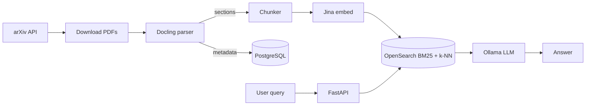

# arXiv RAG: Research Paper Q&A with Multi-Turn Dialogue

> A RAG system that ingests arXiv CS papers every weekday and lets you hold a grounded, multi-turn conversation with them. All LLM inference runs locally, so there is no API key and no per-token billing.

**Repo:** [github.com/aksh-ay06/RAG](https://github.com/aksh-ay06/RAG) · **Stack:** FastAPI, OpenSearch, Ollama (Llama 3.2), Jina embeddings, Docling, Redis, Airflow, Langfuse, PostgreSQL, Gradio, Docker Compose

---

## Problem

The cs.AI and cs.LG categories alone get hundreds of new papers a week. Skimming abstracts doesn't answer questions like *"how do the attention mechanisms in these papers differ?"*. Existing tools either send data to a cloud API or lose track of context after a single turn.

## Approach

- **Hybrid retrieval:** keyword search misses paraphrases, and vector search misses exact terminology. I combined BM25 and k-NN with **Reciprocal Rank Fusion** in a single OpenSearch index, which needs no manual weight tuning.
- **Structure-aware chunking:** Docling extracts each paper's section structure (GPU-accelerated), and chunks follow section boundaries (600 words, 100-word overlap). Each retrieved chunk makes sense on its own instead of starting mid-paragraph.
- **Opt-in sessions:** stateless queries can be served from an exact-match cache (6h TTL). A session starts only when the client sends back a `session_id`, and its history lives in Redis (24h TTL).
- **Production-style ingestion:** an Airflow DAG handles fetch → download → parse → chunk → embed → index, with retries and a run history.
- **Observability:** self-hosted Langfuse traces every stage: embedding, search, prompt construction, and generation.

## Results

| Metric | Value |
|---|---|
| Hybrid search latency | ~72 ms |
| Cached response | ~390 ms (**145× faster** than a full LLM call) |
| Retrieval + embedding | < 500 ms combined |
| PDF parsing (GPU) | 7–35 s per paper |
| LLM generation (Llama 1B, CPU) | ~51 s, the main bottleneck |

## What I'd Do Next

- Build a **RAGAS evaluation harness** on a golden dataset so I can compare chunking strategies and models with actual numbers.
- Add a **cross-encoder reranker** over the top-20 candidates and try **HyDE** query expansion.
- Turn on GPU passthrough for Ollama, which should bring generation from ~51 s to under 2 s.

---

[[projects/index|← All Projects]]
