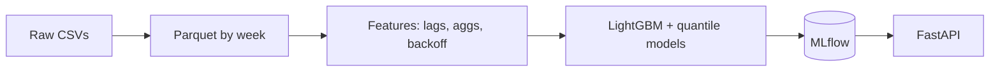

# Grupo Bimbo Demand Forecasting

> Weekly demand forecasts at the client × product × route level, trained on **74M+ historical transactions**, with prediction intervals and a serving API.

**Repo:** [github.com/aksh-ay06/forecasting](https://github.com/aksh-ay06/forecasting) · **Stack:** pandas, LightGBM, MLflow, SHAP, FastAPI, Docker

---

## Business Context

Grupo Bimbo delivers to over a million stores each week across 45,000+ routes. Over-forecasting creates unsold returns (waste), and under-forecasting causes stockouts. The model covers roughly 2,600 products across ~900K clients.

## Approach

- **Memory engineering:** downcasting dtypes shrank the 74M rows from ~6 GB to ~2.4 GB in memory. The data is stored as Parquet partitioned by week for fast access by time.
- **No leakage:** features for week *S* use only data from weeks before *S*, so the model never sees information from the period it predicts.
- **~44 features:** lag features (1–5 weeks), rolling mean/std/median, aggregations across 7 entity groups, attributes parsed from product names (brand, weight, pieces, promo), and a hierarchical backoff.
- **Cold start:** client-product pairs never seen before fall back through a hierarchy (for example, product → route → agency averages).
- **Uncertainty:** separate quantile-regression models produce 10th and 90th percentile bounds alongside each point forecast.
- **Production path:** experiments are tracked in MLflow, results are explained with SHAP, the FastAPI service supports single and batch prediction, and a drift-monitoring module is included.

---

[[projects/index|← All Projects]]
