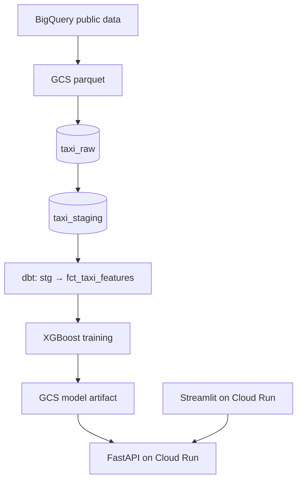

# NYC Taxi Fare Prediction: GCP MLOps Pipeline

> A cloud-native pipeline that goes from BigQuery public data to a deployed model. Features are built with SQL and dbt, an XGBoost model is trained, and a FastAPI backend and Streamlit frontend both run on Cloud Run. All infrastructure is defined in Terraform.

**Repo:** [github.com/aksh-ay06/Trip-Cost-Prediction](https://github.com/aksh-ay06/Trip-Cost-Prediction) · **Stack:** BigQuery, GCS, dbt, XGBoost, FastAPI, Streamlit, Cloud Run, Kestra, Terraform, Docker

---

## Pipeline

## Highlights

- **Infrastructure as code:** Terraform creates the buckets, BigQuery datasets, Artifact Registry, Cloud Run services, and IAM bindings.
- **Layered warehouse:** data moves through raw, staging, and production layers, and dbt builds the staging views and feature mart.
- **Orchestration:** Kestra runs each pipeline step in its own Docker container.

---

[[projects/index|← All Projects]]
