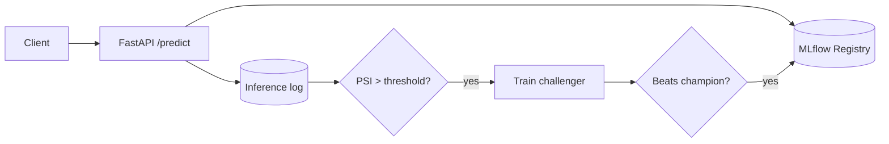

# PMMDS: Production ML Monitoring & Drift Detection

> An end-to-end ML lifecycle system: train → serve → monitor for drift → retrain automatically → promote through a model registry.

**Repo:** [github.com/aksh-ay06/pmmds](https://github.com/aksh-ay06/pmmds) · **Stack:** PySpark MLlib, MLflow, FastAPI, Prefect, Prometheus, Docker Compose

---

## Problem

Models degrade silently once deployed. I wanted to build the whole loop that catches this, not just a training notebook: data validation, real-time serving, drift detection, and a safe way to replace the production model.

## Approach

- **Data & model:** NYC TLC yellow taxi trips (~500K rows after filtering), processed with PySpark. A `GBTRegressor` predicts `fare_amount` from 12 engineered features (time, distance, duration, borough, rate code, and others).
- **Validation:** schema and range checks run on both training and inference inputs.
- **Serving:** FastAPI loads an MLflow pyfunc model and returns request IDs, model version, and latency with each prediction.
- **Drift detection:** per-feature **Population Stability Index** (20 bins). Any feature with PSI above 0.2 triggers an alert. KL and JS divergence are also available.
- **Automated retraining:** when drift is detected, a challenger model is trained and compared with the champion. It is promoted only if its RMSE is at least 0.5 lower, with MAE and R² as secondary checks.
- **Operations:** Prefect orchestrates every pipeline, Prometheus collects metrics (predictions, latency, retraining runs), and all logs are structured JSON.

## Takeaways

The modeling was the easy part. Most of the work went into the guardrails around it: what counts as drift, what evidence justifies a model swap, and how to make every decision auditable.

---

[[projects/index|← All Projects]]
