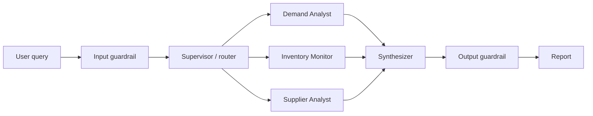

# Supply Chain Intelligence Agents (SCIA)

> A multi-agent LLM system for CPG supply-chain analysis. A supervisor routes each question to specialist agents and combines their findings into one report, with guardrails on both input and output.

**Repo:** [github.com/aksh-ay06/supply-chain-agents](https://github.com/aksh-ay06/supply-chain-agents) · **Stack:** LangGraph, LangChain, Pydantic, pandas, Streamlit, Docker

---

## Architecture

## Design Decisions

- **Supervisor pattern in LangGraph:** narrow questions go to a single agent. A "full report" request fans out to all three agents in parallel.
- **Guardrails as graph nodes:** the input guardrail checks domain relevance (off-topic queries are rejected before any LLM call), prompt-injection patterns, and length. The output guardrail redacts PII, flags hedging language as a possible hallucination, and adds a data disclaimer.
- **Swappable LLM backend:** Ollama, Groq, OpenAI, or Anthropic, chosen with a single environment variable.
- **Adapts to where it runs:** when it detects Streamlit Cloud with Groq's free tier, it runs agents one at a time with exponential backoff to stay within rate limits. Locally, agents run in parallel.

---

[[projects/index|← All Projects]]
