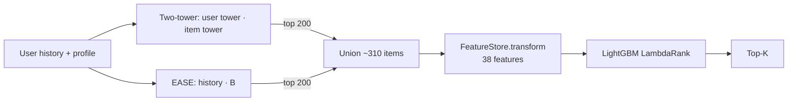

# Two-Stage Recommender: Two-Tower + EASE Retrieval, LightGBM Reranking

> A retrieve-then-rank recommender built from scratch and evaluated the way I'd want a paper to be evaluated: tuned baselines, three protocols, multiple seeds, paired bootstrap CIs, and every modelling decision made on validation before the test set was touched. Built on MovieLens-1M, then repeated on the H&M Kaggle data (31.8M purchases, 105k articles) to see what survives a real catalog.

**Repo:** [github.com/aksh-ay06/two-stage-recommender](https://github.com/aksh-ay06/two-stage-recommender) · **Stack:** PyTorch, LightGBM (LambdaRank), FAISS (HNSW), NumPy/pandas, scikit-learn, pytest

---

## Why I built this

Most recommender tutorials stop at "train a two-tower model, report Recall@K." That skips the part that actually matters in production systems, which is the second stage: a ranker that sees a few hundred candidates and can afford rich features. It also tends to skip the part that matters in research, which is whether the numbers would survive a strong baseline. EASE, a one-line closed-form linear model, is known to beat a lot of neural recommenders on MovieLens when it's tuned properly, so I wanted to see how a two-stage system holds up against it.

I set three questions for myself going in:

1. Does a learned reranker beat the retriever's own ordering, and by how much once you account for noise?
2. Where does the lift actually come from? Is it the model, the features, or just recency?
3. Does any of this transfer from a 3.7k-item movie catalog to a 105k-item fashion catalog with real purchases?

## System design

**Stage 1, retrieval.** Two sources each pull their top 200 from the full catalog, and the union (about 310 items per user) becomes the candidate set.

- *Two-tower (PyTorch).* The user tower embeds user ID, demographics, and the mean of the last 30 item embeddings. The item tower embeds item ID, genres, and a release-year bucket. Both output L2-normalized 64-d vectors. Training uses in-batch softmax at temperature 0.05 with a **logQ correction** for the popularity bias of in-batch negatives, and duplicate positives in a batch are masked. One detail I had to get right: during training, the user's history only includes items *before* the target, otherwise the target leaks into its own input embedding.
- *EASE.* Closed-form item-item model, λ tuned on validation. Cheap, strong, and very different in what it captures (long-run co-occurrence over the whole history, with no notion of order).

**Stage 2, ranking.** A LightGBM LambdaRank model reranks the union using 38 features: both retrievers' score and rank (rank capped at 200 if a source didn't retrieve the item), similarity of the candidate to the user's last 5 items, item popularity (overall and recent), item age and mean rating, user activity, genre affinity, and gaps between the item and the user's usual taste. A `FeatureStore` precomputes all user and item statistics offline, so the online `transform()` step is just lookups and a few vector ops.

## Evaluation setup (the part I spent the most time on)

I tried hard to avoid the usual ways offline recsys numbers get inflated:

- **Three protocols.** *Leave-last-5* per user (3 seeds), a *global time split* with one clock for everyone (much harder, closer to deployment), and *leave-last-5 with only ratings ≥ 4 as positives*.
- **Tuned baselines.** Popularity, Item-kNN and EASE, with tuning grids wide enough that every selected value is in the interior of the grid, not on its edge.
- **No test-set decisions.** Validation users are split 80/20. The 80% train the rankers; the 20% (ranker-holdout) drive early stopping and pick among six ranker variants, including which candidate pool to use. Then everything is refit on train+val and the test set is scored once.
- **Uncertainty.** Paired bootstrap over users (2,000 resamples) for every comparison, plus std across seeds.

A concrete example of why the validation-only rule matters: on seed 42, validation picked a different ranker variant than the one test would have preferred (0.1763 vs 0.1751 NDCG@10 on holdout, so basically a coin flip). I report what validation chose, which makes my headline number slightly worse and the seed-to-seed spread slightly larger. I think that's the honest version.

## Results on MovieLens-1M

NDCG@10 on test:

| Protocol | Two-tower | EASE (tuned) | Two-tower cands + GBM | **Two-stage (selected)** | vs EASE |
|---|---|---|---|---|---|
| Leave-last-5, 3 seeds | 0.113 | 0.071 | 0.139 | **0.158** | +117% to +126% |
| Ratings ≥ 4 only | 0.086 | 0.072 | 0.114 | **0.130** | +80% |
| Global time split | 0.187 | 0.284 | 0.254 | **0.303** | **+6.7% [+2.2, +11.4]** |

![[projects/assets/tsr-ndcg_at_k.png]]

The global time split is the result I care most about. My first version of the system only used two-tower candidates, and on this split it **lost to EASE by 10.7%**. Adding EASE's scores as ranker features didn't fix it (0.270, still below EASE's 0.284). What fixed it was adding EASE as a *candidate source*. The two-tower top 200 contained only 31.7% of what users went on to rate; the union contained 48.7%. The ranker can't surface something that never made it into the pool, so the bottleneck was retrieval, not ranking.

### Where the lift comes from

Ablations on leave-last-5, mean over 3 seeds:

| Ranking | Candidates | NDCG@10 | vs two-tower order |
|---|---|---|---|
| Two-tower score (no reranking) | two-tower | 0.1130 | – |
| Recency similarity alone (heuristic) | two-tower | 0.0872 | −23% |
| GBM, no EASE features | two-tower | 0.1392 | +23% |
| GBM, all features | two-tower | 0.1556 | +38% |
| GBM w/o recency features | union | 0.1330 | +18% |
| **GBM, all features** | **union** | **0.1601** | **+42%** |

A few things I didn't expect:

- **Recency is the most important feature group, but useless on its own.** Dropping the recency similarities costs 17%, yet sorting by them alone is 23% *worse* than the two-tower order. The ranker's value is in weighing short-term intent against long-term co-occurrence, not in either signal by itself.
- **Under leave-last-5, EASE helps more as a feature than as a source** (+12% as features on the same candidates, then another +3% from its candidates). On the global split it was the opposite. Same model, different question being asked of it.
- **EASE collapses for heavy users as a standalone model** (its NDCG@10 is about half the two-tower's in the top activity quartile), because it treats a long history as an unordered set and old taste dominates. As a ranker feature it still helps those same users.

![[projects/assets/tsr-ndcg_by_activity.png]]

### A decision I had to walk back

The first version had a user-occupation feature. It looked reasonable, but validation NDCG@10 on ranker-holdout users was *worse* with it (0.1901 vs 0.1974 without). Looking closer, early stopping was kicking in at 74 trees instead of 152: a feature that is constant within each user's query group gives the ranker an easy way to overfit to user identity. I removed it based on validation alone, and the pipeline now enforces that rule for every variant.

## Scaling up: H&M

MovieLens is small and well studied, so I reran the whole design on the H&M Personalized Fashion data, using weekly stages like the Kaggle competition: test is the last week, validation the week before, and two earlier weeks add ranker training data. Each stage gets its own two-tower model, EASE, feature store and candidates, trained only on that stage's 12-week history window.

The catalog change forced some design changes. With 1.37M customers, most with a handful of purchases, a customer-ID embedding is mostly noise, so the user tower uses age, club status, newsletter frequency and recent purchases instead. Candidates come from four sources: two-tower top 100, EASE top 50, the customer's past purchases (re-buy), and last week's best-sellers, about 163 articles per user.

Test results (49,219 test-week buyers with history, one seed):

| System | MAP@12 | Recall@12 | NDCG@12 |
|---|---|---|---|
| Popularity (last week) | 0.0091 | 0.0255 | 0.0161 |
| Re-buy, then popular | 0.0331 | 0.0634 | 0.0462 |
| EASE (tuned) | 0.0148 | 0.0394 | 0.0247 |
| Two-tower | 0.0076 | 0.0229 | 0.0140 |
| GBM on two-tower candidates | 0.0207 | 0.0419 | 0.0310 |
| **Two-stage (multi-source GBM)** | **0.0404** | **0.0817** | **0.0581** |

The selected system beats "re-buy, then popular", which is a surprisingly hard baseline on fashion data, by **21.8% [+19.5, +24.3] on MAP@12**. These numbers aren't comparable to the Kaggle leaderboard, which scored a different week and included cold-start users.

What H&M taught me that MovieLens didn't:

- **Ranker training data mattered more than any model change.** Going from one to three weeks of ranker training data raised MAP@12 by about 7%. Retraining the two-tower per stage improved the two-tower's own recall (7.7% → 9.3%) but didn't move the final system at all.
- **The two-tower model earns its place as a source, not a signal.** On its own it ranks *below* last-week popularity. As a candidate source it has the highest recall of the four. As ranker features it adds nothing (−0.5% [−1.7, +0.6] when removed).
- **logQ correction is not optional for retrieval.** In smoke runs without it, two-tower recall dropped from 9.5% to 0.7%. The final system barely noticed, because EASE and re-buy cover most of what the two-tower finds, which is its own kind of interesting.
- **Retrieval is still the ceiling.** The four-source union contains only 19% of what users buy. No ranker can beat that, so the next gains are in candidate generation.

## Serving

I measured per-request latency on a single CPU thread (1,000 requests after warm-up, ~310 candidates, 191-tree ranker):

| Step | p50 | p99 |
|---|---|---|
| User tower | 0.6 ms | 1.1 ms |
| Retrieval (two-tower + EASE + union) | 0.6 ms | 6.6 ms |
| Feature transform | 0.8 ms | 1.6 ms |
| GBM scoring | 6.1 ms | 9.1 ms |
| **End to end** | **8.2 ms** | **16.6 ms** |

The GBM is about 75% of the latency, which tells me where to optimize first (fewer trees, fewer candidates, or compiling the model with treelite). I also benchmarked FAISS HNSW against brute-force retrieval on synthetic catalogs up to 1M items. Brute force wins below roughly 50k items, so the MovieLens setup correctly uses no index. At 1M items, HNSW is about 5× faster at 97.6% recall.

![[projects/assets/tsr-retrieval_scaling.png]]

## Online experiment plan

Offline NDCG on "rated it later" is not the same as "clicked it when shown", so I wrote an [A/B test plan](https://github.com/aksh-ay06/two-stage-recommender/blob/main/AB_TEST_PLAN.md) for taking this live. The short version: three arms (current ordering, single-source reranker, multi-source reranker) so the reranker's contribution and the second source's contribution can be measured separately; plays-from-row per exposed user as the primary metric; latency, retention and empty-row rate as non-inferiority guardrails; a power calculation (~190k exposed users per arm after a Bonferroni split, before CUPED); and SRM, A/A and novelty checks before anyone reads the result.

## Limitations

- Only the MovieLens leave-last-5 protocol has three seeds. The global split, ratings ≥ 4, and H&M each have one, so those CIs reflect variation across users, not across training runs.
- Ranker selection on the global split rests on 104 holdout users. It's noisy, and I say so in the repo.
- There is no impression or position data in either dataset, so the ranker learns from "interacted with" rather than "chose this over what else was shown". That's the main reason the online test is needed.
- The 100k and 1M catalogs in the ANN benchmark are synthetic (real item vectors plus noise), so real-world HNSW recall will differ.

## What I'd do next

1. **A sequential user tower** (SASRec-style). I want to know whether it absorbs the recency lift the GBM gets today, and whether it closes the two-tower's gap to EASE on the global split.
2. **More candidate sources for H&M**, like items bought together with recent purchases and trending items by age group, since retrieval recall is the clear ceiling there.
3. **A cheaper ranker**: cap trees, score fewer candidates per source, or compile the model to get GBM scoring well under 6 ms.

---

[[projects/index|← All Projects]]
